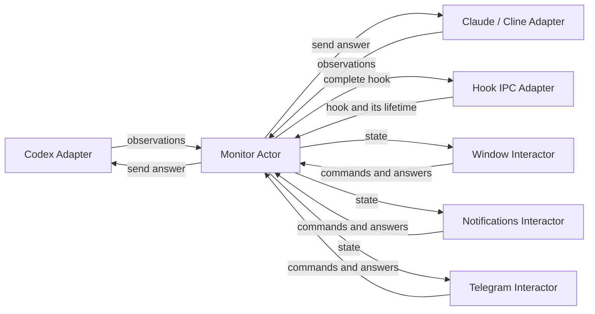
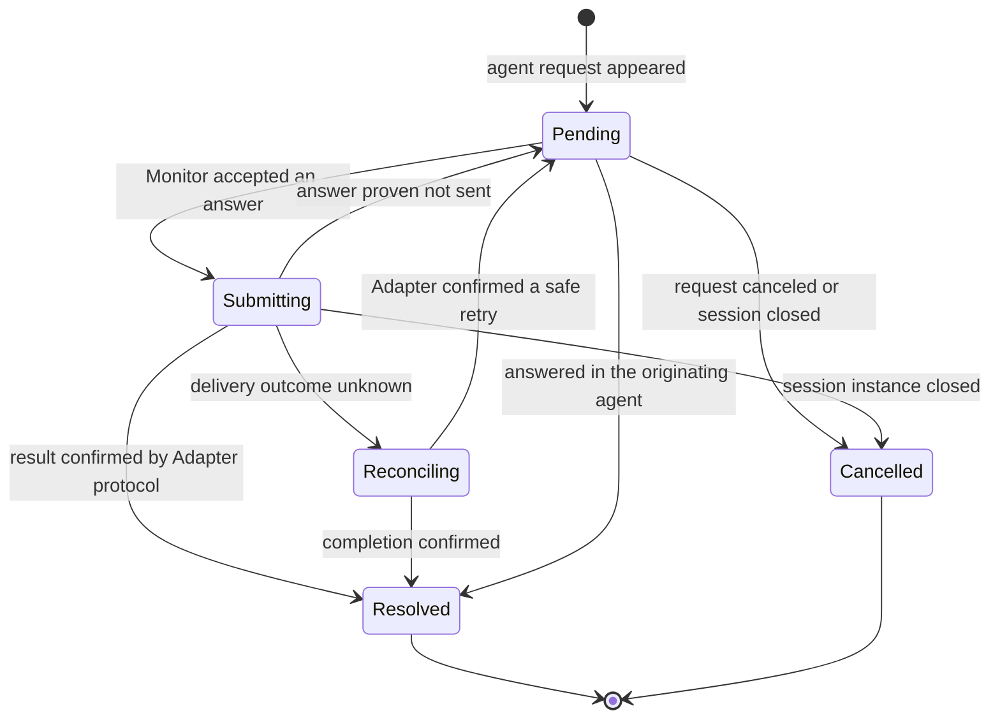

# AI Agent Monitor actor architecture

Status: implemented at the user's request. This document records the agreed contracts and implementation structure. The user performs manual verification of macOS UI behavior.

## 1. Goal

Move from global services and shared mutable tables to actors created when the resident monitor starts. Actors own their state and communicate through Tokio channels.

Main components:

1. **Monitor** — the sole owner of the monitor's complete application state. Receives commands and observations, applies state transitions, and publishes changes to subscribers.
2. **Human Interactor** — an actor for a particular human communication channel. Receives state from Monitor, presents new active requests, forwards answers to Monitor, and removes resolved requests. Implementations: window, system notifications, Telegram.
3. **Agent Adapter** — an actor integrating a particular agent. Observes sessions, maps the agent protocol to the shared model, and sends answers to the agent on Monitor's command.

The application's appearance and existing features are preserved. This document does not call for changing the UI framework or implementing Linux support.

## 2. Original structure and transfer of responsibilities

Before the refactor, state and control were distributed across several locations:

| Before the refactor | Problem | New owner |
| --- | --- | --- |
| `app/monitor.rs`: `HOST`, `STORE`, `RESPONDING`, `SEQUENCE`, `ORIGIN` | Global request tables, separate response synchronization, and implicit hook context | Monitor; IPC message context is passed explicitly |
| `agents/codex/runtime.rs`: `OBSERVER`, tickets, live state | A global observer handles both discovery and responses | Codex Adapter |
| `macos/menu.rs`: `all`, notifications, agent polling | The window participates in discovery and controls other notification channels | Sessions and discovery: Monitor/Agent Adapter; UI state: Window Interactor |
| `macos/telegram.rs`: `COMMANDS`, `STATUS`, independent polling when answering | Telegram receives state through multiple paths and checks the backend itself | Telegram Interactor; the only pre-send validation is in Monitor + Agent Adapter |
| `macos/notification_actions.rs`: `BINDINGS` | Global binding of buttons to requests | Notifications Interactor |
| `macos/answers.rs`: global form list | Forms live independently of the request lifecycle | Window Interactor |

### Strict requirement: no global variables

Application code must contain no global variables, mutable or immutable. `static`, `static mut`, `thread_local!`, and global wrappers around `OnceLock`, `LazyLock`, `Mutex`, atomics, or other containers are prohibited. This also applies to actor handles, registries, caches, counters, flags, UI controllers, and form lists.

`Arc<Mutex<_>>`, a global `ActorSystem`, a service locator, or a hidden singleton does not bypass this requirement. Immutable provider tables and registries are also created at startup and passed explicitly to their owners.

All state belongs to an actor instance or an object created during bootstrap with an explicit lifetime. Mutable discovery, history, usage, settings, and integration caches must have such an owner. Dependencies and handles are passed through constructors.

`const` is allowed for numeric parameters, typed values, and embedded resources: these are constant values, not global variables or state storage. System objects and macOS ABI symbols supplied by external frameworks are not used to store application state.

## 3. Diagram



An Interactor does not call another Interactor or an Agent Adapter. An Agent Adapter does not display notifications. Commands between actors are one-way: there is no reply channel or wait for a result. An Adapter reports observations about changes in its source or delivery state, Monitor updates the state, and subscribers react to the new snapshot.

## 4. State ownership

### Monitor

Monitor owns:

- The list of open sessions and their freshness.
- Each session's latest message.
- Active Human Interactions and their delivery state toward the agent.
- Application and integration settings, connection state, and usage.
- Each request's route to its Agent Adapter and current operations.
- The overall state revision and subscription registry.

The number of pending questions and the presence of working sessions are derived from this state. The menu bar, Telegram, and notifications do not need their own agent scans.

### Agent Adapter

Owns connections, subscriptions, raw protocol state, native request IDs, mappings from answer options to the wire protocol, and caches for log and local database reads. This data is not copied into the UI model and is not available to Human Interactors.

Initially, one actor per agent type is sufficient. Connections to multiple backend processes are its internal resources and child tasks. A separate actor per session is not required.

### Human Interactor

Owns delivery and presentation within its channel:

- What has already been shown and under which external ID.
- Current send, update, and removal attempts.
- Local answer drafts.
- Interface state and the channel's transport.

A copy of Monitor's latest snapshot is a read-only cache. An entry in the delivery ledger does not mean that the question is still active.

For Telegram, this includes the bot connection, polling, rate limits, message IDs, pairing, and access to the token in Keychain. For system notifications, it includes categories, identifiers, and callbacks. For the window, it includes row disclosure, hover, keyboard focus, filtering, scrolling, and open forms.

“Complete Monitor state” means complete application state, not button geometry, every transport buffer, or integration secrets.

## 5. Shared model

The following is a contract sketch, not code ready to copy into the project.

```rust
struct MonitorState {
    epoch: MonitorEpoch,
    revision: StateRevision,
    sessions: BTreeMap<SessionId, AgentSession>,
    preferences: Preferences,
    integrations: IntegrationStates,
    usage: UsageState,
    lifecycle: MonitorLifecycle,
    history: HistoryState,         // requested history data and state
}

struct AgentSession {
    id: SessionId,                 // agent + native session ID
    instance: SessionInstanceId,   // currently open instance
    agent: AgentKind,
    title: String,
    application: Application,
    location: SessionLocation,     // project, working directory, Git branch
    activity: Activity,
    freshness: Freshness,
    last_message: Option<AgentMessage>,
    human_interaction: Option<HumanInteraction>,
}

struct HumanInteraction {
    id: InteractionId,
    revision: InteractionRevision,
    explanation: Option<String>,
    questions: Vec<HumanQuestion>, // at least one question
    phase: InteractionPhase,
    issue: Option<InteractionIssue>, // error in current state, not a command reply
    expires_at: Option<Deadline>,
}

struct HumanQuestion {
    id: QuestionId,
    question: String,
    explanation: Option<String>,
    options: Vec<AnswerOption>,
    allow_custom_answer: bool,
    secret: bool,
}

struct AnswerOption {
    id: OptionId,
    caption: String,
    explanation: Option<String>,
}

struct HumanAnswer {
    interaction_id: InteractionId,
    interaction_revision: InteractionRevision,
    answers: BTreeMap<QuestionId, AnswerValue>,
}

enum AnswerValue {
    Option(OptionId),
    Custom(String),
}
```

A simple approval is an ordinary `HumanInteraction` with one question and options such as **Allow once**, **Allow this conversation**, and **Deny**. The shared model has no separate `can_allow` or special `Allow` execution path. A button caption and an answer identifier are distinct; the Codex Adapter maps them to a Codex decision.

One active interaction may contain multiple questions because agents already support this. An ordinary question has `questions.len() == 1`. An Interactor may present the entire batch or one question at a time, but sends one complete answer to Monitor. `allow_custom_answer` applies to an individual question.

Requests that the integration cannot answer explicitly offer navigation to the originating application; they do not receive an invented Allow button. Navigation capability is described separately from answer options sent to the agent.

`secret` preserves existing behavior: a local secure form can accept the answer, while Telegram does not send the question's contents or accept a secret answer. Channel policy determines permitted presentations.

### Identity

- `SessionId` includes the agent type: identical native IDs from different agents do not conflict.
- `SessionInstanceId` distinguishes closing and subsequently reopening a session.
- Monitor creates `InteractionId` for a specific native request, not from the question text or list position.
- `InteractionRevision` changes when the question, options, or permitted answer methods change.
- `StateRevision` changes on every application-state change; a usage update does not make a question's answer stale.
- `MonitorEpoch` changes after a process restart. A callback from the old process gains no authority in the new one.

Snapshots contain no live `Session::respond()`, provider pointers, or methods with implicit access to a global backend. They are data.

## 6. Commands and Tokio channels

The core principle: **a command expresses intent; new state is the only way to learn the result**. A command has no `reply_to`, response future, or promise of an individual completion. An Interactor does not wait for Monitor to process a command, send an answer to an agent, or complete a request.

| Purpose | Channel | Semantics |
| --- | --- | --- |
| Monitor commands and adapter observations | Bounded `mpsc` | One-way messages, explicit queueing and backpressure |
| Application-state subscription | `watch<Arc<MonitorState>>` | Initial snapshot and latest current state |
| Optional diagnostic events | Bounded `broadcast` | Lag is allowed; not a source of truth |
| Commands to a specific Adapter/Interactor | Its bounded `mpsc` | One-way intent sent to the resource owner |

Channel roles are described in the [Tokio documentation](https://docs.rs/tokio/latest/tokio/sync/index.html) and [channels tutorial](https://tokio.rs/tokio/tutorial/channels). The inter-actor protocol uses neither `oneshot` nor request/reply.

Examples of incoming commands and observations:

```rust
MonitorCommand::ObserveAgent { source, generation, sequence, observation }
MonitorCommand::SubmitAnswer { answer }
MonitorCommand::OpenSession { session_id }
MonitorCommand::LoadPreviousMessage { session_id, cursor }
MonitorCommand::UpdatePreferences { change }
MonitorCommand::ConfigureIntegration { change }
MonitorCommand::RefreshSessions
MonitorCommand::Shutdown
```

`GetSnapshot` is unnecessary: the subscriber already has the current snapshot. Subscriptions and handles are passed when actors are created; there is no `Subscribe` command with a reply channel. `/sessions` reads the local read-only snapshot. When needed, an explicit refresh is requested separately through `RefreshSessions` and arrives as an ordinary state change.

The source of an Interactor command is determined by its handle issued at startup, not by a Telegram field that Monitor blindly trusts. Hook connection context and cancellation are also passed explicitly, without thread-local `ORIGIN`/`CONNECTION`.

### Subscriptions and events

Monitor publishes a new immutable snapshot after a state change. A new subscriber immediately receives the current snapshot and sees questions that are already active.

`watch` may coalesce intermediate updates. This suits current active interactions: a question resolved before delivery to the human no longer needs to be shown. A subscriber reconciles the current request set against its delivery ledger instead of expecting every `Added`/`Removed` exactly once.

If a separate `MonitorEvent::StateChanged { revision, changed_sessions }` is needed, it remains supplementary. A lost broadcast event or `Lagged` leads to reading the latest snapshot, not losing a question. Individual `CommandSucceeded`/`CommandFailed` events must not substitute for a reply channel.

Before `await`, a subscriber clones the `Arc` from `watch`, releasing the borrow. Actors do not share an `Arc<Mutex<MonitorState>>`.

### Errors and results are part of state

- An accepted answer changes `interaction.phase` to `Submitting`.
- Confirmed completion removes the interaction from active state.
- A send failure retains the current interaction and changes its `phase`/`issue`; all Interactors see the same error and retry availability.
- Setup errors belong to the corresponding integration's state; history loading belongs to `HistoryState`.
- Application shutdown is reflected in `MonitorLifecycle`.
- A stale or duplicate command does not change a completed request or create an individual result. The current snapshot already describes its validity.

Do not create a command-result table that the calling actor polls by correlation ID: that would be request/reply under another name. Internal operation IDs exist only to protect against late observations and delivery races.

### Backpressure

Initial implementation capacities: Monitor mailbox 256, each adapter mailbox 64, Interactor network delivery queue 128. These are configurable limits, not requirements for a future API.

Monitor does not wait for HTTP, SQL, Apple Events, or agent responses while handling a command. Before sending a backend command, it reserves space in the adapter mailbox. If no space is available, the question remains active with a busy/send-error state; subscribers learn this from state. After accepting the transition, Monitor publishes a snapshot and sends the command through the reserved slot.

A successful `mpsc::send` means only that the command entered the queue, not that Monitor or the agent accepted it. A closed/full channel is a local transport error: the Interactor retains the draft and may indicate that the command was not queued. This is not Monitor's reply to the command.

State updates are coalesced through `watch`. A human answer must not be silently lost through `try_send`: an async sender waits for space, while the UI uses a bounded send queue without blocking the main thread. Unbounded queues and a `spawn` for every pointer movement are not used.

## 7. Answer lifecycle



Terminal transitions remove `human_interaction` from active state. The completion reason may remain in a bounded operation history, not in a permanent global tombstone table.

Sequence:

1. An Interactor sends `SubmitAnswer` with the request ID and revision.
2. Monitor validates request existence, session instance, revision, expiry, answer completeness, and validity of each option/custom text.
3. Within one command handler, Monitor moves the request to `Submitting` and assigns an internal `OperationId`. Monitor ignores a second answer command for an already submitting or completed request. Its sender sees the same `Submitting` or absence of an active interaction through the subscription.
4. Monitor publishes state. All Interactors block duplicate submission while keeping the question visible.
5. The Agent Adapter revalidates the native request and forwards the answer to the agent. Changes to request/delivery state reach Monitor as Adapter observations while Monitor continues handling other commands. The Adapter does not produce a separate command reply.
6. Once the result is confirmed, Monitor removes the active interaction and publishes state. All Interactors remove the request from their conversations.

The Adapter protocol explicitly defines the confirmation criterion. For Codex IPC, it is confirmed consumption/disappearance of the specific native request. A hook has no such ACK from the agent itself: the internal CLI/IPC protocol must separately confirm that the decision was successfully written and flushed to the hook's stdout. This guarantees delivery into the agent's channel, not a fabricated confirmation of execution. Without confirmation, the result remains uncertain; the decision must not be retried automatically.

The Interactor receives no separate acknowledgment at any step. After queueing the command, it continues processing snapshots. Even if an intermediate `Submitting` was skipped, the interaction's disappearance is sufficient to remove the human-facing request.

The first answer **accepted by Monitor** wins the race. The first click is not considered a successful answer to the agent. A positive transport ACK does not always mean that the agent accepted the decision: Codex's existing request-consumption check must be preserved.

An answer with an unknown delivery outcome must not be retried automatically. `Reconciling` blocks new submissions until an authoritative Adapter result arrives. Exactly-once delivery across processes is not promised without agent-protocol support.

A late delivery observation contains the internal `OperationId`, session instance, and Adapter generation. It cannot remove a new request that appeared after the old one closed. Closing the window or disconnecting the sending Interactor does not roll back an answer already accepted by Monitor.

## 8. Human Interactor algorithm

The shared behavior is the same for the window, notifications, and Telegram. Common reconciliation can be implemented with ordinary types and functions; it needs neither a separate actor nor a universal actor framework.

For every new snapshot:

1. Collect active interactions permitted for this channel.
2. Schedule presentation for a new `(epoch, interaction_id, revision)`.
3. Update an already presented request only if its content or `phase` changed.
4. For a disappeared request, cancel delivery that has not started and remove any already presented UI.
5. If an interaction is still current in the latest snapshot and the human answered, build `HumanAnswer` and queue `SubmitAnswer` to Monitor. Do not wait for a separate acknowledgment or result; continue receiving state.
6. Update the presentation from subsequent state: `Submitting` blocks duplicate sends; an error is displayed; a disappeared/resolved interaction is removed regardless of who answered. If the interaction is already absent from the local snapshot, do not forward a late human answer. Monitor performs the final check for a race against a snapshot that has not yet arrived.

The delivery ledger distinguishes `Queued`, `Sending`, `Delivered`, `Removing`, and `Failed`. A request becomes “shown” only after transport success. While a send is in progress, repeated snapshots do not start a second delivery.

Slow operations carry generation/operation IDs. If a question disappears while Telegram is sending a message, a late success still contains the message ID: the Interactor immediately removes its buttons or deletes the message. An old callback cannot authorize an answer to a resolved question.

A delivery error is channel state, not a change to the question's validity. A failed Telegram HTTP request does not close the interaction in Monitor.

### Window and forms

The window receives sessions through its subscription rather than running discovery. A form is bound to an interaction ID and revision. When Monitor confirms completion, the form closes or displays a completed state with submission disabled. On a revision change, an old draft is not sent to the new question without explicit user action.

Hover, animations, filtering, and row disclosure remain local. Settings change through Monitor commands. The menu bar and footer are derived from the snapshot.

All UI controllers—session windows, answer forms, settings, and menu bar—communicate with Monitor exclusively through channels. They receive read-only state through a subscription and send one-way commands to its mailbox. Controllers do not directly call Monitor, Agent Adapter, discovery, settings storage, or Telegram methods. A channel handle provides no access to the Monitor object and does not conceal synchronous RPC.

### System notifications

Notifications Interactor owns the UNUserNotificationCenter delegate, categories, and action bindings. A callback contains an interaction reference and a local option binding; it becomes `SubmitAnswer`. When an interaction disappears, the Interactor removes the notification and its bindings regardless of where the answer originated.

### Telegram

Telegram Interactor subscribes to Monitor state. Long polling, sending, and message editing do not block state reception or local cancellation. They have bounded concurrency and their own timeouts.

`/sessions` reads Monitor's snapshot; `/status` reads Monitor/integration state. Telegram no longer calls `agents::sessions::open()` for commands or before answering. Monitor validates answer freshness; Telegram user/chat/message/callback validation remains in Telegram Interactor.

Pairing and the token remain the integration's responsibility. Shared state exposes connection status, not the token. Pausing Telegram notifications does not close questions or disable read-only bot commands.

## 9. Agent observation and freshness

An Agent Adapter sends observations with a `generation` and monotonic `sequence`. Monitor ignores old results even if an earlier discovery completes after a newer one.

Observations distinguish:

- Session data changes.
- Interaction appearance/changes.
- Confirmed interaction completion.
- Confirmed closure of a session instance.
- Temporary connection loss or unavailable discovery.

A successful full snapshot has an explicit coverage scope: the sources/connections it describes. An absent record means closure only if the source guarantees a complete, authoritative list for that scope. A partial snapshot or read failure must not become an “empty list.”

During temporary uncertainty, Monitor changes `freshness`, retains the question, and prohibits unsafe submission until Adapter validation. Subscribers must not create a permanent “this question is closed” record from a transient discovery failure.

An open daemon transcript alone does not prove that a terminal or VS Code window is open. Existing process/TTY/window lifetime checks remain the Agent Adapter's responsibility. Moving to actors does not itself remove ambiguity in directory-based CLI matching; matching accuracy is a separate integration concern.

Hook IPC Adapter owns the Unix connection and the hook's pending response. Disconnect/expiry sends an explicit cancellation to Monitor. The external hook protocol still waits for a decision on its connection, but inside the application the Adapter observes request state and delivery commands without inter-actor `oneshot` or a global `Mutex + Condvar`. External protocol ACKs are not replies to inter-actor commands. Local UID validation, size limits, and timeouts are preserved.

## 10. AppKit and Tokio

AppKit stays on the main thread. `NSView`, `NSWindow`, Objective-C delegates, and other objects with `MainThreadMarker` are not sent into `tokio::spawn`.

Window Interactor is a main-thread actor with a Tokio mailbox and a read-only snapshot. The bridge carries only typed data and wakes AppKit through the main dispatch queue. The asynchronous subscription side coalesces updates; a separate render for every intermediate revision must not accumulate on the main thread.

Each controller/delegate's ivars receive only the necessary channel endpoints and local UI state, not a reference to Monitor or other services. Native callbacks use this channel handle. If the queue is full, a callback must not block AppKit or call `block_on`; it indicates busy state or schedules a bounded asynchronous send.

Bootstrap retains the root AppKit delegate and handles for the application's lifetime. Process callbacks route through this object. Existing global `thread_local!` instances are removed; new ones are not introduced. Monitor/Interactor must not be obtainable “from anywhere” through a hidden global reference.

The bridge only delivers data and wakes AppKit; it neither bypasses Monitor's mailbox nor directly calls its business methods. Local rendering calls between UI objects are allowed, but application-state exchange with Monitor always uses channels.

Notifications Interactor uses the same main-thread bridge where platform APIs require it. Application navigation, login-item settings, and other platform effects also use an explicitly passed platform port/bridge; each call does not need its own actor. Monitor's domain logic does not depend on AppKit.

## 11. Startup, failures, and shutdown

Bootstrap performs the following:

1. Checks the bundle location, acquires the resident lock, loads preferences, and creates `MonitorEpoch`.
2. Creates one Tokio runtime, the channels, and Monitor with its initial state.
3. Creates Agent Adapters, Hook IPC Adapter, and Human Interactors, passing each its specific handles and subscriptions.
4. Connects the AppKit bridge and runs the native event loop on the main thread.
5. Retains task handles and resources in an `ActorSystem` created in `main` until application shutdown.

`ActorSystem` is an explicit lifecycle owner, not a new global singleton. Separate CLI commands use IPC and do not create a competing actor system, notifier, or Telegram poller.

Blocking SQLite, file operations, and required synchronous platform code move into bounded `spawn_blocking` jobs. Job completion reaches the owner as an internal event with a generation/operation ID; the owner then updates its state or sends an observation to Monitor. This is an I/O execution detail, not request/reply between actors. Tokio-compatible HTTP/Unix I/O is preferred over subprocesses/blocking loops; the specific HTTP library is chosen during implementation.

If Telegram fails, the window and macOS notifications keep working. If an Agent Adapter fails, Monitor marks the source unavailable rather than deleting all its sessions. Automatic reconnect remains inside the adapter; Monitor controls generation changes. A main Monitor crash explicitly terminates the system rather than starting a new Monitor over old live callbacks.

On Shutdown, Monitor stops accepting new answers, publishes shutdown state, cancels incoming hook waits, asks Interactors to remove requests, closes adapters, and waits for tasks until a shared deadline. Unavailable Telegram must not keep the application alive indefinitely. The listener, resident lock, and runtime are then released.

Native bindings and active response authority are not restored from disk. After a restart, adapters revalidate requests. Persisted Telegram message IDs serve only to remove old buttons, not to restore permission to answer.

## 12. Implementation structure

```text
src/
  domain/                   # pure models without platform I/O
    session.rs
    interaction.rs
    history.rs
    preferences.rs
    telegram.rs
    usage.rs
  actors/
    monitor/
      mod.rs                # command loop and state transitions
      state.rs              # canonical state
      command.rs            # one-way commands
      handle.rs             # mailbox + read-only watch subscription
      tests.rs
    agents.rs               # resource-owning actor per SessionProvider
    human/
      window.rs             # typed main-thread mailbox
      notifications.rs      # subscription, bindings, notification lifecycle
      telegram.rs           # subscription, bot, pairing, delivery ledger
  agents/                   # adapter-owned protocols and discovery
    codex/
    claude/
    cline/
  app/
    actor_system.rs         # runtime, channel, and actor construction
    ipc.rs                  # external CLI/hook protocol and connection lifetimes
    ids.rs                  # identifiers without global counters
  macos/
    menu.rs                 # Window Interactor and AppKit presentation
    answers.rs              # forms owned by Window Interactor
    native.rs               # application root and native callbacks
    bridge.rs               # explicit platform-operation mailbox
    notification_actions.rs # local Notifications Interactor bindings
    notification_categories.rs
    onboarding.rs
    keychain.rs
    terminal.rs
```

Compatible re-exports of shared types remain in their former modules; they are not service locators and store no state. Codex runtime, VS Code, and usage caches belong to a specific adapter instance. Blocking resource jobs return ownership to that same actor; these are not replies to Human Interactor commands.

## 13. Completed refactoring phases

Implementation was performed after the user's explicit instruction:

1. **Domain and contracts.** Introduce IDs, `MonitorState`, shared questions and answers, execution and error states. Verify that existing Codex/Claude/Cline interactions map without losing capabilities.
2. **Bootstrap and Monitor.** Create the runtime and handles; move HookStore, response arbitration, and state publication to Monitor. IPC passes context explicitly. Temporary compatibility facades receive handles through constructors, not through a new static.
3. **Agent Adapters.** Move the Codex observer/tickets and other global backend caches. Remove backend reads from UI and Telegram; preserve native answer validation and consumption confirmation.
4. **Window Interactor.** Subscription replaces discovery; commands replace direct `Session` actions; forms follow the interaction lifetime.
5. **Notifications Interactor.** Own delivery ledger and callbacks; remove notification lifecycle management from the window and Telegram.
6. **Telegram Interactor.** Subscription, `/sessions`/`/status` through Monitor, answers only through Monitor, local HTTP/polling jobs and bindings.
7. **Remove the old path.** Remove all global variables, including immutable registries, handles, and UI thread-local storage, plus redundant pollers, duplicate counters, and unused legacy routes. Verify startup/shutdown and absence of duplicate sends.

During migration, only one old or new executor is active for a given side effect. Two notification senders or two Telegram pollers must not run simultaneously. An actor system with one shared `Arc<Mutex<_>>` behind the old API does not count as a completed migration.

## 14. Verification and completion criteria

Domain transitions use deterministic unit tests. Actors use a fake Agent Adapter, fake human transports, and controlled Tokio time without real Telegram/VS Code.

Required structural check: application code contains no global variables, including `static` and `thread_local!`. Also check hidden singleton wrappers and global handle storage in platform glue. `const` and external ABI declarations from system frameworks are not application state.

Required scenarios:

- A new question appears in all enabled Human Interactors; repeated snapshots do not duplicate delivery.
- An answer from any channel is sent to the agent once; after confirmation, the request is removed from every channel.
- Two simultaneous answers: Monitor accepts one; the second causes no duplicate send. Both Interactors learn the outcome only from state.
- An uncertain backend result causes neither a retry nor false success.
- Answering in the agent also removes the question from the window/form, macOS, and Telegram.
- Temporary discovery loss does not permanently close the question; confirmed window/TTY closure removes the session.
- A late answer/HTTP completion from an old request, generation, or process does not affect a new interaction.
- Slow Telegram poll/send/edit operations do not block Monitor, the window, or system notifications.
- A full queue neither loses answers nor blocks AppKit; local queueing errors are distinct from Monitor's execution state.
- Commands have no `reply_to`, `oneshot`, or individual completion events; Interactors update only from snapshots, including errors.
- The answering Interactor may disconnect before the next snapshot; the others still observe the correct completion.
- A subscriber that missed several revisions reconstructs the current presentation from a snapshot.
- After a restart, old buttons gain no authority and current requests are rediscovered.
- Message history, filtering, keyboard navigation, usage, settings, application visibility, and correct window/terminal navigation are preserved.
- `/sessions` gets its list from Monitor; Telegram and the window do not perform independent discovery.
- UI controllers receive state only through subscriptions and send commands only through channels; they have no direct references to Monitor/Agent Adapter or calls to global services.
- Shutdown releases hook waits and resources even when an external service is unavailable.

The refactor is complete when application code has no global variables, application state has one explicit owner, external participants communicate through passed handles, and existing behavior is confirmed by tests and manual macOS UI verification.

## 15. Agreed decisions

- No global variables; all instances and dependencies are created during bootstrap and passed explicitly.
- All UI controllers communicate with Monitor only through channels, under the same rules as other Human Interactors.
- All inter-actor commands are one-way, without replies; state is the only application-level feedback channel.
- Subscribe to current state through `watch`; a separate diagnostic event stream does not participate in delivery correctness.
- One active interaction per session, containing one or more questions.
- The first answer accepted by Monitor reserves delivery; the request is removed after agent confirmation, not on click.
- Drafts and delivery ledgers belong to Human Interactors; sessions, active requests, and their lifecycle belong to Monitor.
- Initially, one Agent Adapter per agent type; no mandatory per-session actor or additional actor framework.

Implementation checks: 156 unit tests and 4 integration tests, Clippy with `-D warnings`, and a structural check for the absence of global variables. Native interface behavior is additionally checked manually.
