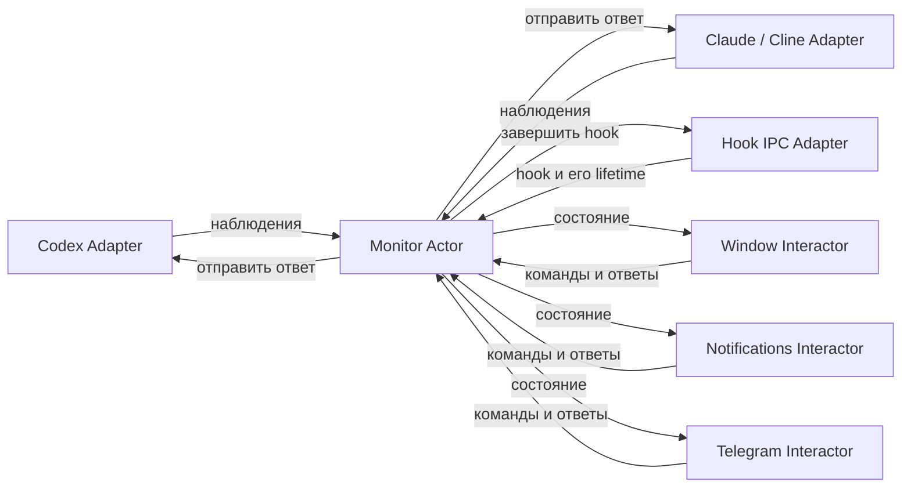
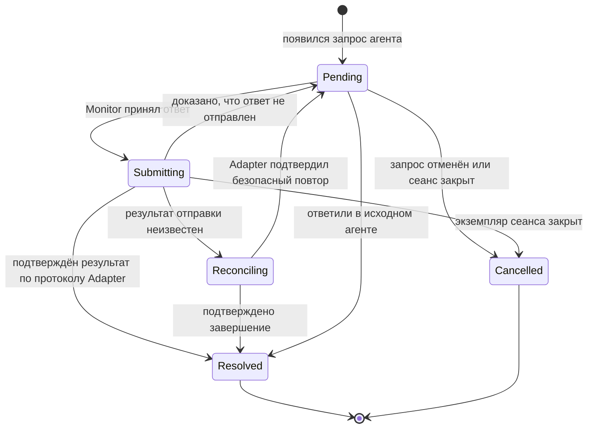

# Акторная архитектура AI Agent Monitor

Статус: реализовано по команде пользователя. Ниже зафиксированы согласованные контракты и структура реализации. Ручная проверка поведения macOS UI выполняется пользователем.

## 1. Цель

Перейти от набора глобальных сервисов и общих изменяемых таблиц к акторам, создаваемым при запуске резидентного монитора. Акторы владеют своим состоянием и взаимодействуют через каналы Tokio.

Основные части:

1. **Monitor** — единственный владелец полного прикладного состояния монитора. Принимает команды и наблюдения, применяет переходы состояния, публикует изменения подписчикам.
2. **Human Interactor** — актор конкретного способа общения с человеком. Получает состояние от Monitor, показывает новые активные запросы, передаёт ответы в Monitor, убирает завершённые запросы. Реализации: окно, системные уведомления, Telegram.
3. **Agent Adapter** — актор интеграции с конкретным агентом. Наблюдает сеансы, преобразует протокол агента в общую модель, отправляет ответы агенту по команде Monitor.

Внешний вид приложения и существующие функции сохраняются. Этот документ не предусматривает изменение UI-фреймворка или реализацию Linux.

## 2. Исходная структура и перенос ответственности

До рефакторинга состояние и управление были распределены между несколькими местами:

| До рефакторинга | Проблема | Новый владелец |
| --- | --- | --- |
| `app/monitor.rs`: `HOST`, `STORE`, `RESPONDING`, `SEQUENCE`, `ORIGIN` | Глобальные таблицы запросов, отдельная синхронизация ответов и неявный контекст hook | Monitor; контекст сообщения IPC передаётся явно |
| `agents/codex/runtime.rs`: `OBSERVER`, tickets, live state | Глобальный наблюдатель одновременно обслуживает discovery и ответы | Codex Adapter |
| `macos/menu.rs`: `all`, notifications, опрос агентов | Окно участвует в discovery и управляет другими каналами уведомлений | Сеансы и discovery — Monitor/Agent Adapter; UI-состояние — Window Interactor |
| `macos/telegram.rs`: `COMMANDS`, `STATUS`, собственный опрос при ответе | Telegram получает состояние разными путями и сам проверяет backend | Telegram Interactor; единственная проверка перед отправкой — Monitor + Agent Adapter |
| `macos/notification_actions.rs`: `BINDINGS` | Глобальная привязка кнопок к запросам | Notifications Interactor |
| `macos/answers.rs`: глобальный список форм | Формы живут отдельно от жизненного цикла запросов | Window Interactor |

### Жёсткое требование: никаких глобальных переменных

В коде приложения не должно быть глобальных переменных — ни изменяемых, ни неизменяемых. Запрещены `static`, `static mut`, `thread_local!` и глобальные обёртки на `OnceLock`, `LazyLock`, `Mutex`, атомиках или других контейнерах. Это относится также к handles акторов, реестрам, кэшам, счётчикам, флагам, UI-контроллерам и спискам форм.

`Arc<Mutex<_>>`, глобальный `ActorSystem`, service locator и скрытый singleton не являются обходом этого требования. Неизменяемые таблицы провайдеров и реестры также создаются при запуске и передаются владельцу явно.

Любое состояние принадлежит экземпляру актора либо объекту, созданному в bootstrap и имеющему явный срок жизни. Изменяемые кэши discovery, истории, usage, настроек и интеграций получают такого владельца. Зависимости и handles передаются через конструкторы.

`const` для числовых параметров, типовизированных значений и встроенных ресурсов допустим: это константные значения, а не глобальные переменные или место хранения состояния. Системные объекты и ABI-символы macOS, предоставляемые внешними frameworks, не используются как хранилище состояния приложения.

## 3. Схема



Interactor не вызывает другой Interactor или Agent Adapter. Agent Adapter не показывает уведомления. Команды между акторами односторонние: без ответного канала и ожидания результата. Adapter сообщает наблюдения об изменении своего источника/доставки, Monitor обновляет состояние, а подписчики реагируют на новый снимок.

## 4. Владение состоянием

### Monitor

Monitor владеет:

- списком открытых сеансов и их актуальностью;
- последним сообщением каждого сеанса;
- активными Human Interactions и состоянием их отправки агенту;
- настройками приложения и интеграций, состоянием подключений, usage;
- маршрутом каждого запроса к Agent Adapter и текущими операциями;
- общей ревизией состояния и реестром подписок.

Число ожидающих вопросов и наличие работающих сеансов вычисляются из этого состояния. Для них не нужен отдельный обход агентов из menubar, Telegram или уведомлений.

### Agent Adapter

Владеет соединениями, подписками, raw protocol state, нативными request IDs, отображением вариантов ответа в wire protocol, кэшами чтения журналов и локальной БД. Эти данные не копируются в UI-модель и не доступны Human Interactors.

Изначально достаточно одного актора на тип агента. Соединения с несколькими backend-процессами — его внутренние ресурсы и дочерние задачи. Отдельный актор на каждый сеанс не требуется.

### Human Interactor

Владеет доставкой и представлением в своём канале:

- что уже показано и под каким внешним ID;
- текущими попытками отправки, обновления и удаления;
- локальными черновиками ответов;
- состоянием интерфейса и транспортом конкретного канала.

Копия последнего снимка Monitor — read-only кэш. Наличие записи в delivery ledger не означает, что вопрос ещё активен.

Для Telegram это bot connection, polling, rate limits, message IDs, pairing и доступ к токену в Keychain. Для системных уведомлений — категории, идентификаторы и callbacks. Для окна — раскрытие строк, hover, keyboard focus, фильтр, scroll и открытые формы.

«Полное состояние Monitor» означает полное прикладное состояние, а не геометрию кнопок, все транспортные буферы и секреты интеграций.

## 5. Общая модель

Ниже — эскиз контрактов, не готовый код для переноса в проект.

```rust
struct MonitorState {
    epoch: MonitorEpoch,
    revision: StateRevision,
    sessions: BTreeMap<SessionId, AgentSession>,
    preferences: Preferences,
    integrations: IntegrationStates,
    usage: UsageState,
    lifecycle: MonitorLifecycle,
    history: HistoryState,         // данные и состояния запрошенной истории
}

struct AgentSession {
    id: SessionId,                 // agent + native session ID
    instance: SessionInstanceId,   // текущий открытый экземпляр
    agent: AgentKind,
    title: String,
    application: Application,
    location: SessionLocation,     // проект, рабочий каталог, git branch
    activity: Activity,
    freshness: Freshness,
    last_message: Option<AgentMessage>,
    human_interaction: Option<HumanInteraction>,
}

struct HumanInteraction {
    id: InteractionId,
    revision: InteractionRevision,
    explanation: Option<String>,
    questions: Vec<HumanQuestion>, // минимум один вопрос
    phase: InteractionPhase,
    issue: Option<InteractionIssue>, // ошибка в актуальном состоянии, не ответ на команду
    expires_at: Option<Deadline>,
}

struct HumanQuestion {
    id: QuestionId,
    question: String,
    explanation: Option<String>,
    options: Vec<AnswerOption>,
    allow_custom_answer: bool,
    secret: bool,
}

struct AnswerOption {
    id: OptionId,
    caption: String,
    explanation: Option<String>,
}

struct HumanAnswer {
    interaction_id: InteractionId,
    interaction_revision: InteractionRevision,
    answers: BTreeMap<QuestionId, AnswerValue>,
}

enum AnswerValue {
    Option(OptionId),
    Custom(String),
}
```

Простое подтверждение — обычный `HumanInteraction` с одним вопросом и вариантами вроде **Allow once**, **Allow this conversation**, **Deny**. Отдельного `can_allow` или специального пути исполнения `Allow` в общей модели нет. Подпись кнопки и идентификатор ответа различаются; перевод в решение Codex выполняет его Adapter.

Один активный interaction может содержать несколько вопросов, потому что это уже поддерживается агентами. Для обычного вопроса `questions.len() == 1`. Interactor может показывать пакет целиком или по одному вопросу, но отправляет в Monitor один полный ответ. Поле `allow_custom_answer` относится к конкретному вопросу.

Запросы, на которые интеграция не умеет отвечать, явно имеют возможность перехода в исходное приложение; они не получают выдуманную кнопку Allow. Возможность навигации описывается отдельно от вариантов ответа агенту.

`secret` сохраняет существующее поведение: локальная защищённая форма может принять ответ, Telegram не отправляет содержимое такого вопроса и не принимает секретный ответ. Разрешённые представления определяются политикой канала.

### Идентичность

- `SessionId` включает тип агента: одинаковые нативные ID у разных агентов не конфликтуют.
- `SessionInstanceId` различает закрытие и последующее открытие сеанса.
- `InteractionId` создаётся Monitor для конкретного нативного запроса, а не из текста вопроса или позиции в списке.
- `InteractionRevision` меняется при изменении вопроса, вариантов или разрешённых способов ответа.
- `StateRevision` меняется при любом прикладном изменении; обновление usage не делает ответ на вопрос устаревшим.
- `MonitorEpoch` меняется после перезапуска процесса. Callback старого процесса не получает полномочий в новом.

Снимки не содержат живых `Session::respond()`, указателей на провайдеры или методов с неявным доступом к глобальному backend. Это данные.

## 6. Команды и каналы Tokio

Базовый принцип: **команда — намерение, новое состояние — единственный способ узнать результат**. У команды нет `reply_to`, ответного future или обещания прислать персональное завершение. Interactor не ждёт, пока Monitor обработает команду, отправит ответ агенту или завершит запрос.

| Назначение | Канал | Семантика |
| --- | --- | --- |
| Команды Monitor и наблюдения адаптеров | Ограниченный `mpsc` | Односторонние сообщения, явная очередь и backpressure |
| Подписка на прикладное состояние | `watch<Arc<MonitorState>>` | Начальный снимок и последнее актуальное состояние |
| Необязательные события для диагностики | Ограниченный `broadcast` | Допускается отставание; не источник истины |
| Команды конкретному Adapter/Interactor | Его ограниченный `mpsc` | Односторонние намерения владельцу ресурса |

Назначения каналов описаны в [документации Tokio](https://docs.rs/tokio/latest/tokio/sync/index.html) и [руководстве по channels](https://tokio.rs/tokio/tutorial/channels). `oneshot` и паттерн request/reply в межакторном протоколе не используются.

Примеры входящих команд и наблюдений:

```rust
MonitorCommand::ObserveAgent { source, generation, sequence, observation }
MonitorCommand::SubmitAnswer { answer }
MonitorCommand::OpenSession { session_id }
MonitorCommand::LoadPreviousMessage { session_id, cursor }
MonitorCommand::UpdatePreferences { change }
MonitorCommand::ConfigureIntegration { change }
MonitorCommand::RefreshSessions
MonitorCommand::Shutdown
```

`GetSnapshot` не нужен: у подписчика уже есть актуальный снимок. Подписки и handles передаются при создании акторов; для них нет команды `Subscribe` с ответным каналом. `/sessions` читает локальный read-only снимок, а явное обновление при необходимости запрашивается отдельной командой `RefreshSessions` и приходит обычным изменением состояния.

Источник команды Interactor задаётся его выданным при запуске handle, а не Telegram-полем, которому Monitor слепо доверяет. Контекст hook-соединения и его отмена также передаются явно, без thread-local `ORIGIN`/`CONNECTION`.

### Подписки и события

Monitor публикует новый неизменяемый снимок после изменения состояния. Новый подписчик сразу получает текущий снимок и видит уже активные вопросы.

`watch` может объединять промежуточные обновления. Это подходит для текущих активных взаимодействий: вопрос, который уже завершился до доставки человеку, показывать не нужно. Подписчик сверяет актуальный набор запросов со своим delivery ledger, а не рассчитывает получить каждое `Added`/`Removed` ровно один раз.

Если нужен отдельный `MonitorEvent::StateChanged { revision, changed_sessions }`, он остаётся вспомогательным. Потеря broadcast-события или `Lagged` приводит к чтению последнего снимка, а не к потере вопроса. Персональные события `CommandSucceeded`/`CommandFailed` не вводятся вместо ответного канала.

Перед `await` подписчик клонирует `Arc` из `watch`, освобождая borrow. Общего `Arc<Mutex<MonitorState>>` между акторами нет.

### Ошибки и результаты — часть состояния

- Принятый ответ меняет `interaction.phase` на `Submitting`.
- Подтверждённое завершение убирает interaction из активного состояния.
- Ошибка отправки оставляет актуальный interaction и меняет его `phase`/`issue`; все Interactors видят одинаковую ошибку и возможность повторить ответ.
- Ошибка настройки находится в состоянии соответствующей интеграции; загрузка истории — в `HistoryState`.
- Завершение приложения отражается в `MonitorLifecycle`.
- Устаревшая или повторная команда не меняет завершённый запрос и не создаёт персональный результат. Текущий снимок уже описывает его актуальность.

Не создаём таблицу результатов команд, которую вызывающий актор опрашивает по correlation ID: это был бы тот же request/reply под другим названием. Внутренние ID операций нужны только для защиты от поздних наблюдений и гонок доставки.

### Backpressure

Начальные ёмкости для реализации: mailbox Monitor — 256, mailbox каждого адаптера — 64, очередь сетевой доставки Interactor — 128. Это настраиваемые пределы, не требования к будущему API.

Monitor не ждёт завершения HTTP-запроса, SQL, Apple Event или ответа агента внутри обработки команды. Для отправки backend-команды он заранее резервирует место в mailbox адаптера. Если места нет, вопрос остаётся активным с состоянием занятости/ошибкой отправки; подписчики узнают об этом из состояния. После принятого перехода Monitor публикует снимок и отправляет команду через зарезервированное место.

Успешный `mpsc::send` означает только помещение команды в очередь, а не её принятие Monitor или агентом. Ошибка закрытого/переполненного канала — локальная ошибка транспорта: Interactor сохраняет черновик и может показать, что команда не была поставлена в очередь. Это не ответ Monitor на команду.

Изменения состояния коалесцируются через `watch`. Ответ человека нельзя молча потерять через `try_send`: async-отправитель ожидает место, а UI использует ограниченную очередь отправки без блокировки главного потока. Неограниченные очереди и `spawn` на каждое движение указателя не используются.

## 7. Жизненный цикл ответа



Терминальные переходы удаляют `human_interaction` из активного состояния. Причина завершения может сохраняться в ограниченной истории операций, но не в вечной глобальной таблице tombstones.

Последовательность:

1. Interactor отправляет `SubmitAnswer` с ID и ревизией запроса.
2. Monitor проверяет наличие запроса, экземпляр сеанса, ревизию, срок действия, полноту ответов и допустимость каждого варианта/своего текста.
3. В одной обработке команды Monitor переводит запрос в `Submitting` и назначает внутренний `OperationId`. Вторую команду ответа на уже отправляемый или завершённый запрос Monitor игнорирует. Её отправитель видит тот же `Submitting` или отсутствие активного interaction через подписку.
4. Monitor публикует состояние. Все Interactors блокируют повторную отправку, сохраняя сам вопрос видимым.
5. Agent Adapter повторно проверяет нативный запрос и передаёт ответ агенту. Изменение состояния запроса/доставки поступает в Monitor как наблюдение Adapter, пока Monitor продолжает обрабатывать другие команды. Отдельного ответа на команду Adapter не формирует.
6. После подтверждения результата Monitor удаляет активное взаимодействие и публикует состояние. Все Interactors убирают запрос из своих диалогов.

Критерий подтверждения задаётся протоколом Adapter явно. Для Codex IPC это подтверждённое потребление/исчезновение конкретного нативного запроса. У hook нет такого ACK от самого агента: внутренний CLI/IPC-протокол должен отдельно подтверждать успешную запись и flush решения в stdout hook. Это гарантия передачи решения в канал агента, а не выдуманное подтверждение его исполнения. Если подтверждения нет, результат остаётся неопределённым; повторять решение автоматически нельзя.

Interactor не получает отдельного подтверждения ни на одном из этих шагов. После постановки команды в очередь он продолжает обрабатывать снимки. Даже если промежуточный `Submitting` был пропущен, исчезновения interaction достаточно, чтобы снять запрос у человека.

Первый **принятый Monitor** ответ выигрывает гонку. Первый клик не считается успешным ответом агенту. Положительный транспортный ACK также не всегда означает, что агент принял решение: существующая проверка потребления запроса Codex должна сохраниться.

При неизвестном исходе отправки нельзя автоматически повторить ответ. `Reconciling` блокирует новые отправки до авторитетного результата Adapter. Exactly-once между процессами без поддержки протокола агента не обещаем.

Позднее наблюдение о доставке содержит внутренний `OperationId`, экземпляр сеанса и поколение Adapter. Оно не может удалить новый запрос, появившийся после закрытия старого. Закрытие окна или отключение отправившего Interactor не откатывает уже принятый Monitor ответ.

## 8. Алгоритм Human Interactor

Общая часть поведения одинакова для окна, уведомлений и Telegram. Общий reconciliation можно реализовать обычным типом и функциями; отдельный актор или универсальный actor framework для него не нужен.

На каждом новом снимке:

1. Собрать активные interactions, разрешённые для данного канала.
2. Для нового `(epoch, interaction_id, revision)` запланировать показ.
3. Для уже показанного запроса обновить представление только при изменении содержимого или `phase`.
4. Для исчезнувшего запроса отменить ещё не начатую доставку и убрать уже показанное представление.
5. Если interaction ещё актуален в последнем снимке и человек ответил, собрать `HumanAnswer` и поставить команду `SubmitAnswer` в очередь Monitor. Не ожидать отдельного подтверждения или результата; продолжать принимать состояние.
6. По следующему состоянию обновить представление: `Submitting` — заблокировать повтор, ошибка — показать её, исчезнувший/завершённый interaction — снять запрос независимо от того, кто ответил. Если interaction уже отсутствует в локальном снимке, поздний ответ человека не отправлять. Гонку с ещё не полученным снимком окончательно проверяет Monitor.

Delivery ledger различает `Queued`, `Sending`, `Delivered`, `Removing`, `Failed`. Запись «показано» возникает после успешного результата транспорта. Пока отправка в процессе, повторный снимок не запускает вторую доставку.

Медленные операции выполняются с generation/operation IDs. Если вопрос исчез, пока Telegram отправлял сообщение, поздний успешный результат всё равно содержит message ID: Interactor сразу снимает кнопки или удаляет это сообщение. Старый callback не разрешает ответить на завершённый вопрос.

Надпись об ошибке доставки — состояние канала, не изменение истинности вопроса. Неудачный HTTP-запрос Telegram не закрывает interaction в Monitor.

### Окно и формы

Окно получает сеансы из подписки, а не запускает discovery. Форма связана с ID и ревизией interaction. Когда Monitor подтверждает завершение, форма закрывается или показывает завершённое состояние с отключённой отправкой. При смене ревизии старый черновик не отправляется в новый вопрос без явного действия пользователя.

Hover, анимации, фильтрация и раскрытие строк остаются локальными. Настройки изменяются командами Monitor. Menubar и footer вычисляются из снимка.

Все UI-контроллеры — окна сеансов, форм ответов, настроек и menubar — взаимодействуют с Monitor исключительно через каналы. Они получают read-only состояние через подписку и отправляют односторонние команды в его mailbox. Прямых вызовов методов Monitor, Agent Adapter, discovery, хранилища настроек или Telegram из контроллеров нет. Канальный handle не предоставляет доступ к объекту Monitor и не скрывает синхронный RPC.

### Системные уведомления

Notifications Interactor владеет UNUserNotificationCenter delegate, категориями и привязками действий. Callback содержит ссылку на interaction и локальную привязку опции; он превращается в `SubmitAnswer`. После исчезновения interaction Interactor снимает notification и его привязки независимо от того, где был дан ответ.

### Telegram

Telegram Interactor подписан на состояние Monitor. Long polling, отправка и редактирование сообщений не блокируют получение состояния и локальных отмен. У них ограниченная параллельность и собственные таймауты.

`/sessions` читает снимок Monitor, `/status` — состояние Monitor/интеграции. Telegram больше не вызывает `agents::sessions::open()` ни для команды, ни перед ответом. Проверка актуальности ответа выполняется в Monitor; проверка Telegram user/chat/message/callback остаётся в Telegram Interactor.

Pairing и token остаются ответственностью интеграции. В общем состоянии публикуется статус подключения, а не token. Пауза Telegram-уведомлений не закрывает вопросы и не выключает read-only команды бота.

## 9. Наблюдение агентов и актуальность

Agent Adapter отправляет наблюдения с `generation` и монотонным `sequence`. Monitor игнорирует старые результаты, даже если более ранний discovery завершился позже нового.

Наблюдения различают:

- изменение данных сеанса;
- появление/изменение interaction;
- подтверждённое завершение interaction;
- подтверждённое закрытие экземпляра сеанса;
- временную потерю связи или недоступность discovery.

Успешный полный снимок имеет явно заданную область покрытия: какие источники/соединения он описывает. Отсутствие записи означает закрытие только если источник гарантирует полный и авторитетный список для этой области. Частичный снимок или ошибка чтения не превращаются в «пустой список».

При временной неопределённости Monitor меняет `freshness`, сохраняет вопрос и запрещает небезопасную отправку до проверки Adapter. Подписчики не должны создавать постоянную запись «этот вопрос закрыт» из кратковременного провала discovery.

Открытый daemon transcript сам по себе не доказывает открытый терминал или окно VS Code. Существующие проверки process/TTY/window lifetime остаются задачей Agent Adapter. Переход к акторам сам по себе не устраняет неоднозначность эвристики сопоставления CLI по директории; точность этого сопоставления — отдельная задача интеграции.

Hook IPC Adapter владеет Unix-соединением и ожидающим ответом hook. Disconnect/expiry отправляет явную отмену в Monitor. Внешний hook-протокол по-прежнему ждёт решение в своём соединении, но внутри приложения Adapter наблюдает состояние запроса и команды доставки, без `oneshot` между акторами и без глобального `Mutex + Condvar`. Протокольные ACK внешних систем не являются ответами на межакторные команды. Локальная проверка UID, ограничение размеров и timeout сохраняются.

## 10. AppKit и Tokio

AppKit остаётся на главном потоке. `NSView`, `NSWindow`, Objective-C delegates и другие объекты с `MainThreadMarker` не отправляются в `tokio::spawn`.

Window Interactor — main-thread actor с Tokio mailbox и read-only снимком. Bridge переносит только типизированные данные и будит AppKit через main dispatch queue. Асинхронная сторона подписки коалесцирует обновления; на главный поток не накапливается отдельный render для каждой промежуточной ревизии.

В ivars каждого controller/delegate явно передаются только необходимые канальные endpoints и локальное UI-состояние, а не ссылка на Monitor или другие сервисы. Native callback использует этот канальный handle. При заполненной очереди callback не блокирует AppKit и не вызывает `block_on`, а показывает явную занятость или планирует ограниченную async-отправку.

Bootstrap удерживает корневой AppKit delegate и handles на время жизни приложения. Процессные callbacks маршрутизируются через этот объект. Существующие глобальные `thread_local!` удаляются; новые не вводятся. Monitor/Interactor нельзя получать «из любого места» через скрытую глобальную ссылку.

Bridge — только доставка данных и пробуждение AppKit; он не обходит mailbox Monitor и не вызывает его бизнес-методы напрямую. Локальные вызовы отрисовки между UI-объектами допустимы, но обмен прикладным состоянием с Monitor всегда проходит через каналы.

Notifications Interactor применяет такой же main-thread bridge там, где он нужен платформенным API. Навигация к приложению, настройки login item и другие платформенные эффекты также проходят через явно переданный platform port/bridge; для каждого такого вызова отдельный актор не требуется. Доменная часть Monitor не зависит от AppKit.

## 11. Запуск, ошибки и завершение

Bootstrap выполняет следующее:

1. Проверяет расположение bundle, получает resident lock, загружает настройки и создаёт `MonitorEpoch`.
2. Создаёт один Tokio runtime, каналы и Monitor с начальным состоянием.
3. Создаёт Agent Adapters, Hook IPC Adapter и Human Interactors, передавая каждому конкретные handles и подписки.
4. Подключает AppKit bridge и запускает нативный event loop на главном потоке.
5. Удерживает handles задач и resources в `ActorSystem`, созданном в `main`, до завершения приложения.

`ActorSystem` — явный владелец жизненного цикла, не новый глобальный singleton. Отдельные CLI-команды используют IPC и не создают конкурирующую систему акторов, notifier или Telegram poller.

Блокирующие SQLite, файловые операции и необходимый синхронный платформенный код выносятся в ограниченные `spawn_blocking` jobs. Завершение такой работы поступает владельцу как внутреннее событие с generation/operation ID, после чего он обновляет своё состояние или отправляет наблюдение Monitor. Это деталь выполнения I/O, не request/reply между акторами. Tokio-compatible HTTP/Unix I/O предпочтительнее subprocess/blocking loop; конкретную HTTP-библиотеку выбираем при реализации.

При отказе Telegram продолжают работать окно и macOS notifications. При отказе Agent Adapter Monitor отмечает источник недоступным, а не удаляет все его сеансы. Автоматический reconnect остаётся внутри адаптера; смена его поколения контролируется Monitor. Падение главного Monitor завершает систему явно, а не запускает новый Monitor поверх старых живых callbacks.

При Shutdown Monitor прекращает принимать новые ответы, публикует завершение, отменяет входящие hook-ожидания, просит Interactors снять запросы, закрывает адаптеры и ждёт задачи до общего deadline. Недоступный Telegram не может удерживать приложение бесконечно. После этого освобождаются listener, resident lock и runtime.

Нативные bindings и активные полномочия ответов не восстанавливаются с диска. После перезапуска запросы заново подтверждаются адаптерами. Сохранённые Telegram message IDs нужны только для снятия старых кнопок, а не для восстановления права ответить.

## 12. Структура реализации

```text
src/
  domain/                   # чистые модели без платформенного I/O
    session.rs
    interaction.rs
    history.rs
    preferences.rs
    telegram.rs
    usage.rs
  actors/
    monitor/
      mod.rs                # цикл команд и переходы состояния
      state.rs              # каноническое состояние
      command.rs            # односторонние команды
      handle.rs             # mailbox + read-only watch subscription
      tests.rs
    agents.rs               # ресурсный актор на каждый SessionProvider
    human/
      window.rs             # типизированный main-thread mailbox
      notifications.rs      # подписка, bindings и lifecycle уведомлений
      telegram.rs            # подписка, бот, pairing и delivery ledger
  agents/                   # протоколы и discovery, принадлежащие адаптерам
    codex/
    claude/
    cline/
  app/
    actor_system.rs         # создание runtime, каналов и акторов
    ipc.rs                  # внешний протокол CLI/hooks и lifetime соединений
    ids.rs                  # идентификаторы без глобальных счётчиков
  macos/
    menu.rs                 # Window Interactor и AppKit presentation
    answers.rs              # формы, принадлежащие Window Interactor
    native.rs               # application root и нативные callbacks
    bridge.rs               # явный mailbox платформенных операций
    notification_actions.rs # локальные bindings Notifications Interactor
    notification_categories.rs
    onboarding.rs
    keychain.rs
    terminal.rs
```

Совместимые re-export путей общих типов сохранены в прежних модулях; они не являются service locator и не хранят состояние. Кэши Codex runtime, VS Code и usage принадлежат конкретному экземпляру адаптера. Ресурсные блокирующие jobs возвращают владение этому же актору; это не ответы на команды Human Interactors.

## 13. Выполненные этапы рефакторинга

Реализация выполнена после явной команды пользователя:

1. **Домен и контракты.** Ввести ID, `MonitorState`, общие вопросы и ответы, состояния выполнения и ошибок. Проверить отображение существующих Codex/Claude/Cline interactions без потери возможностей.
2. **Bootstrap и Monitor.** Создать runtime и handles, перенести HookStore, арбитраж ответов и публикацию состояния в Monitor. IPC передаёт контекст явно. Временные совместимые фасады получают handle через конструктор, а не через новый static.
3. **Agent Adapters.** Перенести Codex observer/tickets и остальные глобальные backend-кэши. Убрать чтение backend из UI и Telegram; сохранить нативную проверку ответа и подтверждение его потребления.
4. **Window Interactor.** Подписка вместо discovery, команды вместо прямых `Session` actions, формы связаны с interaction lifetime.
5. **Notifications Interactor.** Собственный delivery ledger и callbacks; снять управление notification lifecycle с окна и Telegram.
6. **Telegram Interactor.** Подписка, команды `/sessions`/`/status` через Monitor, ответы только через Monitor, локальные HTTP/polling jobs и bindings.
7. **Удаление старого пути.** Удалить все глобальные переменные, включая неизменяемые registries, handles и UI thread-local storage, а также лишние pollers, дубли счётчиков и неиспользуемые legacy routes. Проверить startup/shutdown и отсутствие двойных отправок.

На промежуточном этапе для конкретного side effect активен только один старый или новый исполнитель. Нельзя одновременно включать два notification sender или два Telegram poller. Акторная система с одним общим `Arc<Mutex<_>>` под старым API не считается завершением миграции.

## 14. Проверки и критерии завершения

Для domain transitions используются детерминированные unit-тесты; для акторов — fake Agent Adapter, fake human transports и управляемое Tokio-время без настоящего Telegram/VS Code.

Обязательная структурная проверка: в коде приложения отсутствуют глобальные переменные, включая `static` и `thread_local!`. Проверяются также скрытые singleton-обёртки и хранение глобального handle в платформенном glue. `const` и внешние ABI-объявления системных frameworks не являются состоянием приложения.

Обязательные сценарии:

- Новый вопрос одновременно появляется во всех включённых Human Interactors; повторный снимок не дублирует доставку.
- Ответ из любого канала отправляется агенту один раз; после подтверждения запрос снимается во всех каналах.
- Два одновременных ответа: Monitor принимает один, второй не вызывает повторной отправки; оба Interactors узнают итог только из состояния.
- Неопределённый результат backend не вызывает повторную отправку и ложный успех.
- Ответили в агенте: вопрос исчезает также из окна/формы, macOS и Telegram.
- Временная потеря discovery не закрывает вопрос навсегда; подтверждённое закрытие окна/TTY снимает сеанс.
- Поздний ответ/HTTP completion старого запроса, поколения или процесса не меняет новый interaction.
- Медленный poll/send/edit Telegram не останавливает Monitor, окно или системные уведомления.
- Переполненная очередь не теряет ответы и не блокирует AppKit; локальная ошибка постановки отличается от состояния выполнения в Monitor.
- У команд нет `reply_to`, `oneshot` или персональных completion-событий; Interactor обновляется только по снимкам, включая ошибки.
- Отправивший ответ Interactor может отключиться до следующего снимка: остальные всё равно увидят правильное завершение.
- Подписчик пропустил несколько ревизий: восстановил актуальное представление из снимка.
- После restart старые кнопки не получают полномочий, актуальные запросы обнаруживаются заново.
- Сохраняются история сообщений, фильтр, keyboard navigation, usage, настройки, application visibility и правильная навигация к окну/терминалу.
- `/sessions` берёт список из Monitor; Telegram и окно не имеют независимого discovery.
- UI-контроллеры получают состояние только по подписке и отправляют команды только через канал; у них нет прямых ссылок на Monitor/Agent Adapter или вызовов глобальных сервисов.
- Shutdown освобождает hook-ожидания и ресурсы даже при недоступном внешнем сервисе.

Рефакторинг завершён, когда в коде приложения нет глобальных переменных, прикладное состояние имеет одного явного владельца, внешние участники взаимодействуют через переданные handles, а существующее поведение подтверждено тестами и ручной проверкой macOS UI.

## 15. Согласованные решения

- Никаких глобальных переменных; все экземпляры и зависимости создаются в bootstrap и передаются явно.
- Все UI-контроллеры общаются с Monitor только через каналы, на тех же условиях, что остальные Human Interactors.
- Все межакторные команды односторонние, без ответов; состояние — единственный прикладной канал обратной связи.
- Подписка на актуальное состояние через `watch`; отдельный поток диагностических событий не участвует в корректности доставки.
- Один активный interaction на сеанс, внутри — один или несколько вопросов.
- Первый ответ, принятый Monitor, резервирует отправку; запрос снимается после подтверждения агента, а не в момент клика.
- Черновики и delivery ledger принадлежат Human Interactors; сеансы, активные запросы и их lifecycle — Monitor.
- Сначала один Agent Adapter на тип агента; без обязательного актора на каждый сеанс и без дополнительного actor framework.

Проверки реализации: 156 unit-тестов и 4 интеграционных теста, Clippy с `-D warnings`, структурная проверка отсутствия глобальных переменных. Поведение нативного интерфейса дополнительно проверяется вручную.
