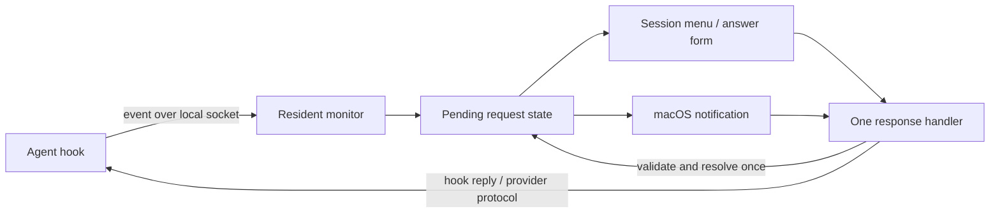

# Integration notes

This document describes the current implementation. For installation and everyday use, see the [README](../README.md).

## Actor runtime

The resident creates an explicit `ActorSystem` with a Tokio runtime. The Monitor actor exclusively owns application state and publishes immutable snapshots through `watch`. Agent adapters and human interactors exchange one-way commands through bounded `mpsc` channels; commands have no reply handles. Queue acceptance is not agent confirmation: sending, uncertain delivery, and errors are represented in the next state snapshot.

Window controllers, native notifications, and Telegram subscribe to the same state. Each owns its presentation and delivery bookkeeping, submits answers to Monitor, and removes resolved interactions when the state changes. Monitor arbitrates concurrent answers; provider adapters revalidate the exact native request and report delivery evidence. Blocking protocol and filesystem work runs outside the state loop. AppKit objects stay on the main thread behind an explicit channel bridge.

There are no application global variables, thread-local controllers, singleton registries, or global caches. Dependencies and channel handles are injected at startup. Pure models live in `src/domain`, actor implementations in `src/actors`, provider protocols in `src/agents`, and platform presentation in `src/macos`. See the [architecture document](actor-architecture.md) for the contracts and lifecycle.

## Native application

AI Agent Monitor uses Rust with AppKit, UserNotifications, and the system SQLite library. The runtime is a single executable inside a locally signed `.app` bundle. Swift is only used by the optional menu bar asset generator; it is not needed for ordinary builds or use.

The session menu is an `NSMenu` with custom content. AppKit owns its presentation and dismissal. The main list is the only scroll region; expanded messages do not introduce nested scrolling. Pointer sampling runs in common run-loop modes so hover stays independent of the first responder and native menu tracking. Keyboard selection and pointer hover are separate states.

The bundle identifier remains `local.codex.agent-monitor.notify` to preserve existing notification authorization and preferences. The bundle command writes the compiled version and build number into `Info.plist`. It creates `build/AIAgentMonitor.previous` once when replacing an existing bundled executable.

## First-launch setup and disk images

Only the resident app invokes onboarding. Hook clients and diagnostic commands never install integrations. If the resident is not running, a hook can launch the installed app in the background; its normal first-launch setup remains the only automatic installer. Onboarding discovers existing Codex/Claude configuration or known VS Code extensions and Cline storage, then runs the existing idempotent installers off the UI thread. It does not install agent software, enable login items, override Codex trust, or toggle Cline's own hook setting.

Successful setup is remembered per agent, configuration directory, and executable path. Failures remain retryable; unrelated agents can still complete setup. New agents can be connected on a later launch or using **Check & set up** in the Integrations settings section. The section shows detected agents, inspects the current hook configuration, reports setup progress and errors, and explains remaining agent-side steps. No separate setup-results window is shown; macOS still handles its own notification authorization prompt.

Hooks from another copy of this app bundle are migrated to the current executable path. Commands outside the named app bundle, extra arguments, and unrelated hooks are preserved. Configuration backups and existing installer validation still apply.

Launching directly from `/Volumes` or App Translocation displays installation instructions and exits before acquiring the resident lock or writing hooks. The user must drag the bundle to a stable location such as Applications first.

The `dmg` command packages the current executable, ad-hoc signs the bundle, creates a compressed read-only disk image with an Applications shortcut, and writes a SHA-256 checksum. Asset names identify the native architecture; no universal-binary claim is made.

## Codex discovery

The provider finds rollout files open for writing by the current user's Codex processes, reads metadata from the local database in read-only mode, and reads transcript state. Titles come from the exact session ID, with renamed titles taking priority. It does not substitute another chat's title.

Transcript tails are limited to the latest 4 MiB for message reading. If lifecycle events lie outside the tail, the provider scans backward to resolve the status. File identity and boundary checks invalidate cached data after rewrites or rotation. A session can be open without currently running a turn.

Terminal sessions also require a live Codex client with a controlling TTY. A shared app-server daemon can retain rollouts after the terminal closes, so daemon file handles alone do not keep them visible. Explicit resume IDs take priority; otherwise clients are matched one-to-one by their original launch directory, considering the most recently updated sessions first. Directory matching is a fallback when the CLI does not expose its current thread ID.

### VS Code windows and workspace identity

A shared Codex process may retain a loaded transcript after a VS Code window closes. Open transcript handles alone therefore do not establish that a window is still open.

The provider combines `Codex.log` thread ownership records, the current extension-host generation, `exthost.log`, and `workspaceStorage/workspace.json`. It accepts live log handles held by Code Helper and records belonging to that host's current lifetime. Closed windows are excluded on refresh; reopening restores discovery. If window discovery is unavailable, transcript-based discovery remains a conservative fallback.

Workspace mapping is separate from live-window membership: a deleted folder does not hide a session in an otherwise live window. Recent unambiguous mappings take priority. Commands executed in other directories do not redefine the editor's project. Multi-root workspaces use the original session working directory for the session details.

Navigation uses the VS Code URL handler. It opens a project, not a particular chat. If a suitable path no longer exists, navigation activates VS Code without opening the missing folder.

### Live requests and questions

The provider observes the local Codex client socket at `$CODEX_HOME/ipc/ipc.sock`. It validates socket ownership and permissions, discovers the owning client, and subscribes as a follower. It does not advertise ownership or accept agent operations.

Snapshots and revisioned patches maintain request state. Periodic resubscription obtains fresh state; invalid revisions and reconnects invalidate cached observations. The protocol is internal and version-dependent. Unsupported versions are ignored, with logs and hooks retained as fallbacks.

Native requests can expose command/file approval choices, proposed policy amendments, scoped permissions, and `item/tool/requestUserInput`. When `availableDecisions` exists, it is authoritative. Approval request payloads contain decision values rather than localized button captions, so the monitor maps supported values to the installed Codex UI wording (for example, Allow once and Deny). The original decision value and JSON request-ID type are preserved on the wire. An IPC acknowledgement is followed by a stream-state check that the exact request disappeared; acknowledgement alone is not treated as a successful answer. Unknown request types and option pickers without an addressed response route open the editor instead.

Asynchronous questions are separate: `request_user_input_async` records questions in agent-message history, and a turn can be idle while a question still needs an answer. The provider retains a compact history projection with question metadata and user replies, rather than complete agent text and tool output. Answered questions and questions superseded by new user input are removed.

After an explicit user choice, an asynchronous answer is encoded with the original `questionItemId` in the native reply format. It is sent as a user message in a new turn or as input steering the active turn, inheriting the thread's settings. Passive observation does not start a turn or invoke a model.

## Responses and notifications

The provider creates opaque, process-local tickets bound to the session, owner, and full pending request. Before responding, it rediscovers the same owner, obtains fresh state, and checks that the exact request still exists, including its thread, turn, and parameters. A stale ticket fails closed. Responses are not automatically retried after a timeout.

The shared `Interaction` / `Response` model represents offered actions, answer choices, custom text, and multiple questions. The UI does not construct provider-specific permission decisions. Forms require an explicit answer; secret inputs use native secure text fields.

Each live notification receives its own immutable action category. A response must match the request key and exact category. Up to four actions are registered; larger sets route through a full form or expanded monitor view. The visible banner layout and number of directly visible actions belong to macOS.

The resident owns all notification category registration, preserving unrelated active categories. Registration is acknowledged before posting. Resolved requests remove their notification bindings and categories; cancellation is rechecked around asynchronous delivery. After a text-response failure, the full form can reopen with the draft preserved.

### Resident-owned hook requests

All Codex, Claude Code, and Cline hook commands are thin IPC clients. They forward their event and originating process identity to the resident over `monitor.sock`, then print its result to the agent. They never post notifications or interpret a permission decision themselves. If the resident is not running, the client starts the installed app in the background and waits for the socket. Failure returns control to the agent without granting permission.

`sessions --json`, `setup`, and `notification-settings` are also IPC clients. Notification authorization and diagnostic queries execute in the resident, so a short-lived diagnostic command cannot register a competing Notification Center client. Only the resident creates the notification delegate.

The socket is owned by the current user with mode `0600`; peers are checked with `getpeereid`. Messages use bounded, length-prefixed JSON and timeouts. `AI_AGENT_MONITOR_SOCKET` can select an explicit socket for isolated diagnostics; an explicit override disables automatic app launch. Agent hook stdout contains only the monitor's protocol result.

Pending hook approvals live in the monitor's memory with unique process-scoped request IDs. They are merged into session discovery immediately, including requests whose session has not otherwise been discovered. Only the monitor registers and posts their request-specific notification actions. There are no per-notification sender processes or response files for new requests.

`Session` is pure snapshot data. The menu, answer forms, macOS notifications, and Telegram enqueue `Monitor::Command::Submit` with the exact displayed request and the explicit response. Monitor rejects duplicate in-flight submissions, validates the current snapshot, and either records a hook decision or commands the owning provider adapter. Interactors observe completion or failure through state; they do not receive command replies. Resolved state removes the request from every presentation, regardless of where the answer originated. External hook IPC still returns the result required by the agent protocol; its connection adapter observes Monitor state to produce that result.

A hook waits up to 60 seconds for an explicit one-time **Allow**. Expiry, a disconnected hook client, or a monitor restart invalidates the request without approval. Dismissing a notification leaves its request available in the monitor until it is answered or expires. Clicking the notification body opens the editor and defers a hook request to the agent’s own prompt without approving it. Old notification bindings are removed on resident startup. Legacy file-backed requests can be read during an upgrade, but no new ones are published.

## Claude Code and Cline

Claude Code installs lifecycle hooks and `PermissionRequest` in its settings. Existing hook groups and permission rules are preserved, with a private configuration backup before changes.

Cline installs executable lifecycle wrappers into its Hooks directory. Existing third-party hook files are not overwritten. Current task state is read from `ui_messages.json` in standard VS Code storage or `~/.cline/data/tasks`. Only the latest task for each host is tracked, rather than scanning task history. `SessionShutdown`, when available, closes task state; host termination also removes its sessions.

Snapshots are stored under `~/Library/Application Support/AI Agent Monitor/agents` with access restricted to the current user. They are bound to the agent or extension-host PID and process start time, so closed processes and reused PIDs do not retain sessions.

Cline's public `pressPrimaryButton()` API does not identify a specific task or request. The monitor therefore routes approval back to Cline instead of risking approval of a different request. This does not change Cline's built-in permission or auto-approval settings.

## Preferences and quota

The settings window uses an `NSTabViewController` with a native preferences toolbar. General preferences, the global shortcut, and the observed application catalog are saved in the app's `NSUserDefaults` domain. Application IDs are independent of display names; discovery updates names and icons without resetting visibility. Closed and disabled applications remain in the catalog.

Application switches filter the window's sessions, alongside the title query. They do not delete session state, disable providers, or suppress notifications and the menu bar activity indicator.

Codex quota is derived from the newest valid `token_count.rate_limits` report in recent local transcripts, cached for ten seconds. It displays `100 − used_percent`, with no network account query. Expired windows display `—` until a new report arrives. Reading quota or session state does not invoke a model.

## Adding an agent provider

Implement `SessionProvider` and register its constructor in `src/agents/sessions.rs::adapters`. Bootstrap creates one adapter actor for each provider, with exclusive ownership of its caches and native protocol state. Common session and interaction types live in `src/domain/session.rs` and `src/domain/interaction.rs`.

A provider supplies open sessions, activity, navigation targets, and supported interactions. UI keys include the provider identity, so identical session IDs from different agents do not collide. `Approval.id` is an opaque token to the UI, not a response-file path.

Discovery must never authorize actions. A response implementation must verify that the request still belongs to the intended session and remains current before sending an explicit user decision.

## Personal Telegram bots

The resident starts a single background worker for the user-owned bot. Settings holds a secure token input and an expiring pairing link. Tokens are stored through Security.framework in Keychain, never in JSON preferences or subprocess arguments. Nonsecret bot identity, private chat/user IDs, update offset and delivered message IDs are saved atomically with mode 0600 in `telegram.json` under Application Support.

The worker uses the official [Telegram Bot API](https://core.telegram.org/bots/api), via HTTPS POSTs and `getUpdates` long polling. A single background inbound poll runs separately from the delivery loop, so waiting for incoming updates does not delay new questions or local resolutions. Poll results from a previous connection generation are discarded. It checks bot identity and refuses bots configured with a webhook. No relay or inbound listener is needed. A random 128-bit `/start` payload binds a single private account for replies. Callback payloads contain random request handles and option indices, rather than commands or native agent IDs.

Requests come from the same resident snapshots and hook events as macOS notifications. Button captions and action IDs come from the agent interaction abstraction. Callback processing validates the paired sender, chat, message ID and current random handle. It checks the subscribed Monitor snapshot and enqueues `Command::Submit` with the exact approval/interaction. Monitor and the owning provider adapter remain the response boundary; Telegram never performs its own session discovery or sends native agent replies. Freeform replies must reference the pending bot message; structured questions collect all answers before submitting. Secret questions expose no answer controls or private text.

Resolved, expired and superseded requests lose their remote response authority and their messages are edited to remove buttons. Confirmed delivery suppresses delayed observations of the same request. A temporary loss of authoritative stream state preserves the existing question but disables replies until its authority can be checked again; confirmed session closure removes it. `sessions --json` includes token-free Telegram connection, queue and snapshot diagnostics. Old buttons do not regain authority after restart. Delivery and message edits use bounded network timeouts and retry failures without logging credentials. Initial network/pairing verification requires a real user-owned bot; protocol and authorization tests run without Telegram credentials.

Telegram commands are registered for the paired private chat with `setMyCommands` and `setChatMenuButton`. `/sessions` reads the current Monitor snapshot, includes idle sessions, sorts titles within application groups and splits long results into bounded messages. `/status` and `/help` provide monitor state and command guidance. Command responses include a persistent reply keyboard and are queued with paced delivery; pending agent questions take priority. Commands require the paired private account, remain available while notifications are paused, and never interpret text as shell commands.
